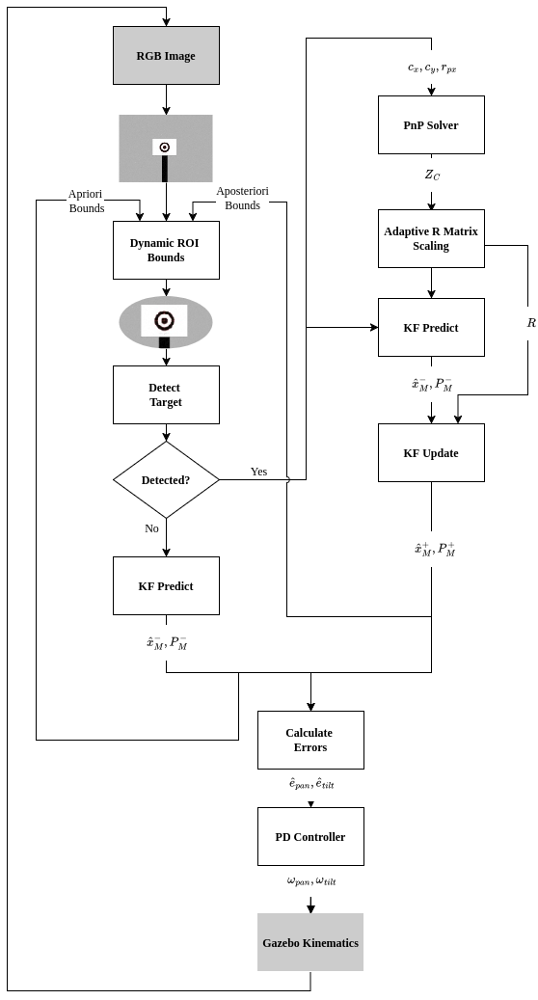

# Resource-Efficient 2-DoF Vision-based Target Tracking

[](https://creativecommons.org/licenses/by-nc/4.0/)
[](#) *(Note: Temporary placeholder link)*

**Author:** Önder İhsan Kul, *Undergraduate Researcher, Istanbul Technical University*

## Abstract
Visual target tracking in agile robotics is often limited by strict Size, Weight, and Power (SWaP) constraints. While deep learning models excel at feature extraction, their computational latency and bounding-box jitter introduce phase lag that destabilizes high-frequency closed-loop control. To address this, we present a resource-efficient, low-latency 2-DoF visual tracking framework that entirely bypasses deep-learning overhead. Our architecture couples a classical vision stack—utilizing HSV filtering, Hough transforms, and complete-linkage clustering—with a predicting Kalman filter to dynamically generate regions of interest (ROI), aggressively bounding the pixel-processing space. To guarantee stability during high-speed maneuvers, we introduce a physics-informed Adaptive-R covariance mechanism. Finally, we derive a conservative, sensor-only mathematical precision bound $r_{th}$ to evaluate tracking performance without external motion capture data. Evaluations demonstrate robust precision and variance suppression, establishing a rigorous, computationally lightweight alternative for dynamic robotic tracking.

## System Architecture & Visuals

*   **System Simulation:**
    * [Simulation Youtube Video Link](https://www.youtube.com/watch?v=0KLxBMH--0o)
*   **System Architecture:** 

     

*   **System Demo:**

    <video src="manuscript/system_demo_gif.mp4" autoplay loop muted playsinline width="100%"></video>

## Related Work & Code
This manuscript relies on the ROS2 workspace and algorithms implemented in the following repository:
*   [Target Tracking Workspace](https://github.com/ondercool/target-tracking-ws.git) 

## Citation
While this manuscript is currently pending formal processing on arXiv, please use the following temporary citation if referencing this work:

```bibtex
@misc{kul2026targettracking,
  author = {Kul, {\"O}nder {\.I}hsan},
  title = {Physics-Informed Vision-Based Target Tracking: Dynamic ROI, Adaptive Noise Modeling, and Sensor-Only Evaluation},
  year = {2026},
  publisher = {GitHub},
  howpublished = {\url{[https://github.com/ondercool/](https://github.com/ondercool/)[target-tracking-paper]}}
}